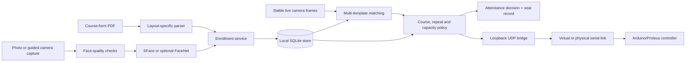

# AuraPass

AuraPass is an offline examination-access prototype that connects course-form enrollment, local face matching, exam eligibility, seat assignment, audit records, and an Arduino/Proteus gate co-simulation.

Built by **Peters Elijah Temidayo, professionally known as Elijah Peters**, as an Electrical & Electronics Engineering project.

> **Prototype status:** this repository is an engineering demonstration, not a production biometric security product. It has no liveness detector, institutional backend, encrypted biometric store, or fabricated gate. See [Limitations](#limitations) before evaluating or extending it.

## What is implemented

| Area | Current implementation |
| --- | --- |
| Enrollment | Extracts a student record and course codes from the supported course-form PDF layout; rejects duplicate matric numbers. |
| Guided capture | Prompts right, left, and centre samples, checks image quality, and stores multiple templates. The prompts do **not** estimate or verify head pose. |
| Recognition | OpenCV YuNet + SFace by default. DeepFace/FaceNet is optional. A deterministic LBP mode exists only for development and logic testing. |
| Local records | SQLite schema for students, courses, templates, sessions, seats, attendance decisions, and system events. |
| Exam policy | Verifies active-course registration, denies a repeat scan in the same session, assigns a unique seat, and reports a full hall. |
| Seat placement | Prefers a seat not adjacent to the same course; if that is impossible, it falls back to another free seat. |
| Hardware link | Sends `V`, `O`, `C`, and `F` commands through loopback UDP to a configurable serial/Proteus bridge. |

## Architecture



The full module and data-flow description is in [docs/ARCHITECTURE.md](docs/ARCHITECTURE.md). The controller protocol is documented in [docs/HARDWARE.md](docs/HARDWARE.md).

## Repository map

```text
app/          Tkinter enrollment, exam-terminal and administration interfaces
aurapass/     Database, parsing, enrollment, recognition and policy services
docs/         Architecture, models, hardware, privacy and testing notes
examples/     Fictional, non-biometric course-form fixture
firmware/     Arduino controller firmware
models/       Download instructions; vendor binaries remain untracked
schematics/   Proteus project retained from the co-simulation
tests/        Synthetic unit and integration tests
tools/        Database, model, fixture and serial-bridge utilities
```

No enrolled faces, captures, databases, embeddings, course PDFs, attendance logs, benchmark datasets, or private test reports are included.

## Try the automated tests without a camera or Proteus

The **synthetic test path** is the simplest way to explore the public project. It exercises the supported fictional course-form fixture, database and exam-policy logic, numeric-vector recognition tests, and controller-command encoding. **No actual face captures, Arduino, or Proteus installation are needed for these automated tests.**

From the repository root, use Python 3.10+:

```powershell
python -m venv .venv
# Activate .venv for your operating system and shell.
python -m pip install -e ".[dev]"
python tools\create_synthetic_course_form.py
python -m ruff check aurapass app tools tests
python -m pytest -q
python -m compileall -q aurapass app tools tests
```

The tests do **not** establish biometric accuracy, liveness detection, security of a deployed system, or operation of a physical gate. See [testing scope](docs/TESTING.md) and [limitations](#limitations). To run the Windows GUI and Proteus simulation, follow the full setup below.

## Quick start

Python 3.10 or later is required. The current sanitized repository was validated with Python 3.14.4.

```powershell
python -m venv .venv
.\.venv\Scripts\Activate.ps1
python -m pip install --upgrade pip
python -m pip install -e ".[dev]"
python tools\download_models.py
python tools\init_database.py
```

Create or refresh the fictional example PDF:

```powershell
python tools\create_synthetic_course_form.py
```

Launch the interfaces from the repository root:

```powershell
python app\registration_app.pyw
python app\exam_terminal.pyw
python app\admin_panel.pyw
```

The registration interface accepts the generated `examples\synthetic_course_form.pdf`, but it still requires an operator-supplied face sample. Do not enroll a real person without a lawful purpose, informed consent, appropriate retention rules, and access controls.

### Optional FaceNet backend

The default and best-documented path is SFace. To evaluate the optional DeepFace/FaceNet path:

```powershell
python -m pip install -e ".[facenet]"
$env:AURAPASS_EMBEDDING_MODE = "facenet"
```

Enrollment and live probes must use the same backend. Existing templates must be rebuilt when changing backends.

## Configuration

| Environment variable | Default | Purpose |
| --- | --- | --- |
| `AURAPASS_RUNTIME_DIR` | `runtime/` | Parent directory for the database, saved face images, captures, and logs. |
| `AURAPASS_DB_PATH` | `runtime/database/aurapass.db` | Optional database override. |
| `AURAPASS_MODEL_DIR` | `models/` | Directory containing the SFace and YuNet ONNX files. |
| `AURAPASS_EMBEDDING_MODE` | `sface` | `sface`, `facenet`, or the development-only `offline_lbp`. |
| `AURAPASS_UDP_HOST` | `127.0.0.1` | Local hardware-bridge bind target. |
| `AURAPASS_UDP_PORT` | `9090` | Local hardware-bridge port. |
| `AURAPASS_SERIAL_PORT` | `COM3` | Serial/COMPIM port used by the bridge. |
| `AURAPASS_BAUD_RATE` | `9600` | Serial baud rate. |

## Proteus and controller workflow

1. Load the project under `schematics/` in Proteus and compile/upload [firmware/gate.ino](firmware/gate.ino) to the simulated Arduino Uno.
2. Connect Proteus COMPIM to a matching virtual serial pair.
3. Set `AURAPASS_SERIAL_PORT` to the Python side of that pair.
4. Run `python tools\proteus_bridge.py`.
5. Start the AuraPass exam terminal.

The Python bridge reports a successful local send, not a confirmed physical actuation. The current protocol has no acknowledgement or readback channel.

## Tests

```powershell
python -m pytest -q
python -m ruff check aurapass app tools tests
python -m compileall -q aurapass app tools tests
```

The public suite uses only fictional records and synthetic numeric vectors. It covers the parser fixture, SQLite constraints, course eligibility, repeat denial, capacity denial, controller command encoding, multi-template matching, ambiguity rejection, and enrollment-collision logic. See [docs/TESTING.md](docs/TESTING.md).

## Privacy and safety

Face images and embeddings are sensitive biometric information. Runtime material is excluded by `.gitignore`, and saved image paths are stored relative to the runtime directory. The current local database is plaintext; protect the host account and storage, collect only what is necessary, and define deletion procedures before any real evaluation.

More detail: [docs/SECURITY_AND_PRIVACY.md](docs/SECURITY_AND_PRIVACY.md).

## Limitations

- No liveness or presentation-attack detection.
- No claim of production accuracy, fairness, false-accept rate, or deployment readiness.
- Recognition thresholds are prototype settings and have not been independently calibrated for a target population.
- The PDF parser targets one known course-form text layout and may reject or misread other layouts.
- Guided right/left/centre prompts do not verify pose.
- SQLite records and face templates are not encrypted at rest.
- Seat separation is a preference, not a guarantee when capacity or layout prevents it.
- Database writes and hardware transmission are separate operations, not one atomic transaction.
- The controller channel has no acknowledgement, checksum, encryption, or device authentication.
- The repository contains a Proteus co-simulation, not evidence of a fabricated production gate.

## Model attribution

Vendor model binaries are downloaded from OpenCV Zoo and are not committed. YuNet is provided there under the MIT License; SFace is provided there under Apache-2.0. Exact URLs and SHA-256 values are in [docs/MODELS.md](docs/MODELS.md).

## Open-source license

Unless otherwise noted, AuraPass source and documentation in this repository are available under the [MIT License](LICENSE), copyright (c) 2026 **Peters Elijah Temidayo, professionally known as Elijah Peters**. The license permits commercial use subject to its notice requirements. Separately downloaded YuNet/SFace models and other third-party material retain their own upstream license terms.

Contributions are welcome; please read [CONTRIBUTING.md](CONTRIBUTING.md). AuraPass remains a **research/engineering prototype**, not a production-ready biometric security product.
