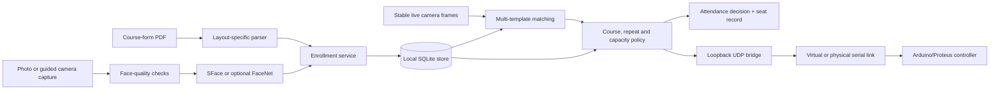

# AuraPass

[](https://github.com/Elijahpeters/AuraPass/actions/workflows/ci.yml)
[](LICENSE)

AuraPass is an offline examination-access prototype that links course-form enrollment, local face matching, course eligibility, seat assignment, audit records, and an Arduino/Proteus gate co-simulation.

Built by **Peters Elijah Temidayo, professionally known as Elijah Peters**, as an Electrical & Electronics Engineering project.

[Synthetic demo](#synthetic-demo) · [Installation](#installation) · [Architecture](docs/ARCHITECTURE.md) · [Privacy](docs/SECURITY_AND_PRIVACY.md) · [Contributing](CONTRIBUTING.md) · [v0.1.0 release notes](docs/releases/v0.1.0.md) · [Engineering case study](https://peterselijah.name.ng/projects/aurapass)

> **Prototype notice:** AuraPass is an engineering demonstration, not a production biometric security or attendance system. It has no liveness detection, institutional backend, or encrypted biometric database. Recognition thresholds are uncalibrated prototype settings; no accuracy, fairness, or deployment claim is made.

## Synthetic demo

Try the examination-policy workflow first. It uses fictional students and injected synthetic match outcomes to show one grant and four denials. The demo needs Python 3.10 or later and only the Python standard library; it does not need an installation, camera, model files, Arduino, Proteus, or a serial bridge.

From the repository root in PowerShell or Command Prompt:

```powershell
py -3 tools\synthetic_exam_demo.py
```

If the Windows Python launcher is unavailable, run `python tools\synthetic_exam_demo.py`. The script uses a temporary SQLite database and removes it on exit. Printed controller commands are dry-run text and are never transmitted.

| Scenario | Decision | Demonstrated policy |
| --- | --- | --- |
| Registered student, seat available | Grant | Assigns seat 1 and prints the dry-run `V`/`O` commands. |
| Same student scanned again | Deny | Rejects a repeat scan in the same session. |
| Student not registered for the active course | Deny | Rejects course ineligibility. |
| Registered student, hall already full | Deny | Rejects when the session has no free seat. |
| No synthetic identity match supplied | Deny | Logs and rejects a no-match result. |

The table describes policy decisions only. The demo does not run face recognition or evaluate biometric performance. Its output is captured from the runnable script; the full transcript is available below.

<details>
<summary>Show the synthetic demo transcript</summary>

```text
AuraPass synthetic exam-access demo
Fictional records and injected policy outcomes only; no biometric analysis is performed.
One-seat EEG501 session; controller commands are printed and never transmitted.

[1] Registered student, seat available
Decision: GRANTED
Reason: Access granted.
Student: Alex Example (DEMO-001)
Course: EEG501
Seat: 1
Controller dry run: V,DEMO-001,EEG501;O,1

[2] Same student scanned again
Decision: DENIED
Reason: Already scanned. Seat 1.
Student: Alex Example (DEMO-001)
Course: EEG501
Seat: 1
Controller dry run: C

[3] Student not registered for the active course
Decision: DENIED
Reason: Student is not registered for today's course.
Student: Casey Sample (DEMO-002)
Controller dry run: C

[4] Registered student, hall already full
Decision: DENIED
Reason: Hall capacity is full.
Student: Riley Fiction (DEMO-003)
Course: EEG501
Controller dry run: F

[5] No synthetic identity match supplied
Decision: DENIED
Reason: No synthetic match was supplied.
Controller dry run: C

Demo database is temporary and will be removed on exit.
```

</details>

## What is included

| Area | Current implementation |
| --- | --- |
| Enrollment | Parses the supported course-form PDF layout and rejects duplicate matric numbers. |
| Guided capture | Checks image quality and stores multiple samples; right/left/centre prompts do not verify head pose. |
| Recognition | OpenCV YuNet + SFace by default; optional DeepFace/FaceNet. Development-only LBP mode is not a secure recognizer. |
| Local records | SQLite stores student/course records, templates, exam sessions, seats, attendance decisions, and system events. |
| Exam policy | Checks course registration, repeat scans, seat availability, and seat placement; records each decision. |
| Hardware link | Sends `V`, `O`, `C`, and `F` commands through loopback UDP to a serial/Proteus bridge. |

## Repository map

| Path | Contents |
| --- | --- |
| `app/` | Tkinter enrollment, exam-terminal, and administration interfaces. |
| `aurapass/` | Database, parser, enrollment, recognition, and policy services. |
| `docs/` | Architecture, hardware, model, privacy, testing, and release notes. |
| `examples/` | Fictional, non-biometric course-form fixture. |
| `firmware/` and `schematics/` | Arduino firmware and Proteus co-simulation project. |
| `models/` | Model download instructions; vendor binaries remain untracked. |
| `tests/` | Synthetic unit and integration tests. |
| `tools/` | Demo, model/fixture setup, database utilities, and serial bridge. |

## Installation

The synthetic demo above is the quickest way to try policy decisions. The full application also installs its Python dependencies and, for face matching, downloads model files separately.

### Windows setup

Install Python 3.10 or later and Git. In PowerShell:

```powershell
git clone https://github.com/Elijahpeters/AuraPass.git
cd AuraPass
py -3 -m venv .venv
.\.venv\Scripts\Activate.ps1
python -m pip install --upgrade pip
python -m pip install -e ".[dev]"
```

If PowerShell activation is unavailable, use `.venv\Scripts\python.exe` in place of `python` for the remaining commands.

Generate or refresh the fictional course-form fixture and initialize the local database:

```powershell
python tools\create_synthetic_course_form.py
python tools\init_database.py
```

For face recognition, download the pinned YuNet and SFace model files:

```powershell
python tools\download_models.py
```

The downloader verifies SHA-256 checksums. Model binaries are not stored in this repository; see [model setup and attribution](docs/MODELS.md) for upstream licenses.

Launch an interface from the repository root:

```powershell
python app\registration_app.pyw
python app\exam_terminal.pyw
python app\admin_panel.pyw
```

Each interface runs as a separate process. The registration interface can read the fictional `examples\synthetic_course_form.pdf`, but a real enrollment still requires an operator-supplied face sample. Do not enroll anyone without an appropriate lawful purpose, consent, retention policy, and access controls.

### Optional FaceNet backend

To install the optional DeepFace/FaceNet dependencies:

```powershell
python -m pip install -e ".[facenet]"
$env:AURAPASS_EMBEDDING_MODE = "facenet"
```

Enrollment and live probes must use the same backend. Rebuild templates after intentionally changing backends.

## Development and tests

The automated checks use fictional records and synthetic numeric vectors. They do not need downloaded face models, a camera, Arduino, or Proteus. Install the development extra if you have not already:

```powershell
python -m pip install -e ".[dev]"
python tools\create_synthetic_course_form.py
python -m ruff check aurapass app tools tests
python -m pytest -q
python -m compileall -q aurapass app tools tests
```

See [docs/TESTING.md](docs/TESTING.md) for coverage and limits. Passing tests does not establish biometric accuracy, liveness detection, demographic fairness, electrical safety, controller actuation, or readiness for deployment.

## Architecture



See [the component and data-flow guide](docs/ARCHITECTURE.md) and [the controller protocol](docs/HARDWARE.md).

## Hardware co-simulation

The Proteus schematic and Arduino firmware are retained for the existing co-simulation workflow:

1. Open `schematics/` in Proteus and compile/upload [firmware/gate.ino](firmware/gate.ino) to the simulated Arduino Uno.
2. Connect Proteus COMPIM to a matching virtual serial pair.
3. Set `AURAPASS_SERIAL_PORT` to the Python-side port.
4. Run `python tools\proteus_bridge.py`, then start the exam terminal.

A successful local send is not confirmation of physical actuation. The current controller protocol has no acknowledgement or readback channel.

## Configuration

| Environment variable | Default | Purpose |
| --- | --- | --- |
| `AURAPASS_RUNTIME_DIR` | `runtime/` | Parent directory for the database, saved face images, captures, and logs. |
| `AURAPASS_DB_PATH` | `runtime/database/aurapass.db` | Optional database override. |
| `AURAPASS_MODEL_DIR` | `models/` | Directory containing downloaded model files. |
| `AURAPASS_EMBEDDING_MODE` | `sface` | `sface`, `facenet`, or development-only `offline_lbp`. |
| `AURAPASS_UDP_HOST` | `127.0.0.1` | Local hardware-bridge bind target. |
| `AURAPASS_UDP_PORT` | `9090` | Local hardware-bridge port. |
| `AURAPASS_SERIAL_PORT` | `COM3` | Serial/COMPIM port used by the bridge. |
| `AURAPASS_BAUD_RATE` | `9600` | Serial baud rate. |

## Privacy and limitations

Face images and embeddings are sensitive biometric information. Runtime data is excluded from Git, but the local SQLite database and templates are **not encrypted at rest**. The software does not implement operator authentication, consent capture, retention scheduling, automated deletion, liveness checks, or controller authentication. Protect the host, minimize collection, and define deletion procedures before any real evaluation. See [security and privacy notes](docs/SECURITY_AND_PRIVACY.md).

Other limitations include:

- Recognition thresholds are prototype settings and have not been calibrated for a target population.
- The parser targets one known course-form text layout.
- Guided right/left/centre prompts do not estimate or verify pose.
- Seat separation is a preference and can fall back to another free seat.
- A database grant and a later hardware send are not one atomic operation.
- The repository contains a Proteus co-simulation, not evidence of a production gate.

## Project documentation

- [Architecture](docs/ARCHITECTURE.md)
- [Hardware protocol](docs/HARDWARE.md)
- [Model setup, checksums, and licenses](docs/MODELS.md)
- [Security and privacy](docs/SECURITY_AND_PRIVACY.md)
- [Testing scope](docs/TESTING.md)
- [Contributor guidelines](CONTRIBUTING.md)
- [AuraPass v0.1.0 release notes](docs/releases/v0.1.0.md)
- [Engineering case study](https://peterselijah.name.ng/projects/aurapass)

No enrolled face images, captures, databases, embeddings, attendance logs, benchmark datasets, or private evaluation reports are included in the repository.

If AuraPass is useful to your research or learning, consider starring the repository, sharing reproducible feedback, or contributing a focused change.

## License

Unless otherwise noted, AuraPass source and documentation are available under the [MIT License](LICENSE), copyright (c) 2026 **Peters Elijah Temidayo, professionally known as Elijah Peters**. The separately downloaded YuNet and SFace model files retain their respective upstream MIT and Apache-2.0 terms; other third-party components retain their own licenses.

Contributions are welcome. Please read [CONTRIBUTING.md](CONTRIBUTING.md) before opening a pull request.
